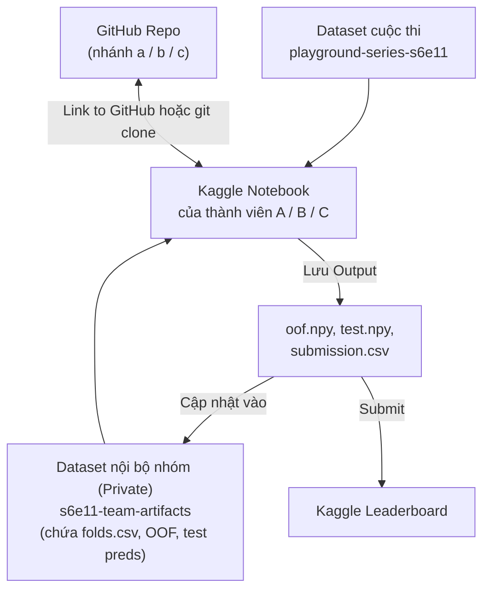
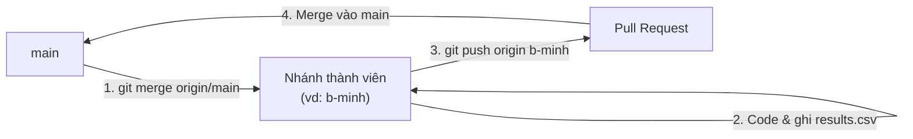

# Hướng dẫn sử dụng Kaggle & GitHub cho nhóm

Tài liệu này hướng dẫn từng bước cách nhóm phối hợp giữa **Kaggle Notebook** (nơi chạy model chính) và **GitHub** (nơi lưu code và lịch sử thí nghiệm).

---

## Phần 1: Thiết lập ban đầu (Giai đoạn 0)

### 1. Lấy Kaggle API Token (dùng khi muốn tải dữ liệu / submit từ máy local)
1. Vào **Settings** trên Kaggle → mục **API** → nhấn **Create New Token**.
2. File `kaggle.json` sẽ được tải về. Di chuyển vào `~/.kaggle/kaggle.json`:
   ```bash
   mkdir -p ~/.kaggle
   mv ~/Downloads/kaggle.json ~/.kaggle/kaggle.json
   chmod 600 ~/.kaggle/kaggle.json
   ```
3. **Tuyệt đối không** đưa file `kaggle.json` vào thư mục repo.

---

## Phần 2: Quy trình làm việc trên Kaggle Notebook (Chạy chính)

Vì cả nhóm chạy trên Kaggle là chính, cần thống nhất cách **dùng chung dữ liệu phụ (`folds.csv`, features)** và **chia sẻ kết quả OOF/Predictions** để làm Ensemble.



### Bước 1: Tạo 1 Kaggle Dataset nội bộ (Private) cho nhóm
Để cả 3 người dùng chung `folds.csv` và gom file OOF về một chỗ:
1. Tạo file `folds.csv` (2 cột: `id,fold`, chia bằng `StratifiedKFold(n_splits=5, shuffle=True, random_state=42)`).
2. Vào menu **Datasets** trên Kaggle → **New Dataset** → đặt tên ví dụ `s6e11-team-artifacts` → để chế độ **Private**.
3. Trong tab **Settings → Sharing** của Dataset đó, thêm 2 thành viên còn lại với quyền **Collaborator (Can Edit)**.
4. Khi tạo bất kỳ Notebook nào của cuộc thi, nhấn **Add Input** → gắn thêm dataset `s6e11-team-artifacts`. Lúc này mọi thành viên đều đọc được `/kaggle/input/s6e11-team-artifacts/folds.csv`.

### Bước 2: Viết và chạy Notebook trên Kaggle
1. Vào trang cuộc thi → tab **Code** → **New Notebook**.
2. Ở thanh bên phải (**Settings**):
   - **Accelerator:** chọn **GPU T4 x2** hoặc **GPU P100** khi train XGBoost/CatBoost/Neural Net; chọn **None (CPU)** khi chỉ EDA hoặc chạy LightGBM nhẹ để tiết kiệm quota (~30h GPU/tuần/người).
   - **Persistence:** có thể bật *Files only* nếu làm việc nhiều phiên.
   - **Internet:** bật **On** nếu cần `git clone` repo hoặc cài thêm thư viện.
3. Nếu muốn gọi các hàm dùng chung trong thư mục `src/` của GitHub repo ngay trên Kaggle Notebook:
   ```python
   !git clone -b <nhanh-cua-ban> https://github.com/NhHung07/Predicting-Credit-Card-Fraud.git
   import sys
   sys.path.append("/kaggle/working/Predicting-Credit-Card-Fraud")
   ```
4. Cuối mỗi Notebook huấn luyện, luôn lưu đủ 3 file ra `/kaggle/working/`:
   - `<exp_id>_oof.npy` (hoặc `.parquet`/`.csv` có cột `id,pred`) — dự đoán out-of-fold trên tập train (`shape = (699960,)`).
   - `<exp_id>_test.npy` — dự đoán xác suất trung bình 5 fold trên tập test (`shape = (299984,)`).
   - `<exp_id>_sub.csv` — file nộp có đúng 2 cột `id,is_fraud`.
5. Nhấn **Save Version** → chọn **Save & Run All (Commit)** để Kaggle chạy nền từ đầu đến cuối và giữ lại tab **Output**.

### Bước 3: Đồng bộ Notebook về GitHub
Có 2 cách:
- **Cách 1 (Trực tiếp trên Kaggle):** Trên thanh menu của Kaggle Notebook, chọn **File → Link to GitHub** → sau khi Save Version có thể chọn commit thẳng file `.ipynb` vào nhánh của bạn trên repo `NhHung07/Predicting-Credit-Card-Fraud`.
- **Cách 2 (Tải về máy):** Chọn **File → Download Notebook (.ipynb)** → đặt vào `notebooks/kaggle/` hoặc `notebooks/scratch/<A|B|C>/` trong repo local → commit và push lên nhánh của mình (công cụ `nbstripout` sẽ tự động dọn output nặng nếu đã bật).

### Bước 4: Nộp bài (Submit) & Ghi nhật ký
- **Nộp từ Kaggle Notebook Output:** Mở bản Save Version vừa chạy xong → tab **Output** → chọn file `<exp_id>_sub.csv` → nhấn **Submit**.
- **Nộp bằng dòng lệnh (nếu tải file về máy):**
  ```bash
  kaggle competitions submit -c playground-series-s6e11 \
    -f outputs/submissions/<exp_id>.csv \
    -m "<exp_id> | CV: 0.9xxx | features: ... | params: ..."
  ```
- **Ghi kết quả:** Cập nhật ngay 1 dòng vào [`experiments/results.csv`](../experiments/results.csv) trên nhánh của bạn để cả nhóm biết mô hình nào đang tốt nhất.

### Bước 5: Chọn 2 bài nộp cuối cùng (Trước 30/11/2026 23:59 UTC)
- Vào tab **Submissions** của cuộc thi → đánh dấu tick vào **2 bài nộp** dùng để tính điểm Private Leaderboard:
  1. **Bài 1:** Ensemble có điểm **CV AUC** cao nhất và ổn định nhất.
  2. **Bài 2:** Một bản Ensemble khác công thức hoặc model đơn lẻ mạnh nhất có cả CV và Public LB tốt (phòng trường hợp bài 1 bị overfit).

---

## Phần 3: Quy trình sử dụng GitHub theo nhánh thành viên

Nhóm sử dụng mô hình **mỗi thành viên một nhánh cố định theo tên** (`a-<ten>`, `b-<ten>`, `c-<ten>`) và nhánh chính `main`.



### Khởi tạo lần đầu (mỗi thành viên làm 1 lần)
```bash
git clone https://github.com/NhHung07/Predicting-Credit-Card-Fraud.git
cd Predicting-Credit-Card-Fraud

# Chuyển sang nhánh theo tên của mình (ví dụ: a-hung, b-nam, c-linh)
git checkout a-hung
git push -u origin a-hung
```

### Chu kỳ làm việc hằng ngày
```bash
# 1. Đảm bảo đang ở nhánh của mình và kéo cập nhật mới nhất từ main
git checkout a-hung
git fetch origin
git merge origin/main

# 2. Thêm notebook / code / cập nhật experiments/results.csv
git status
git add .
git commit -m "exp: lgbm_a_v2 cv=0.9412 add ratio features"
git push origin a-hung
```

### Đưa kết quả tốt vào `main`
- Khi có một notebook/module hoàn chỉnh hoặc cập nhật bảng `experiments/results.csv`, mở **Pull Request** từ nhánh cá nhân (`a-hung`) vào `main` trên giao diện web GitHub.
- Nhờ 1 thành viên khác kiểm tra nhanh rồi nhấn **Merge pull request**.
- File `.gitattributes` đã được cấu hình `experiments/results.csv merge=union`, nên khi 2 thành viên cùng thêm dòng mới vào `results.csv` ở 2 nhánh khác nhau, Git sẽ **tự động giữ lại cả hai dòng** mà không báo xung đột (conflict).
