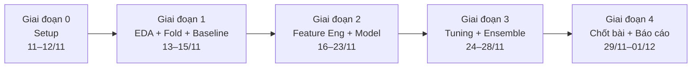

# Lộ trình & Phân công (11/11 – 01/12/2026)

- **Cuộc thi:** [Kaggle Playground Series S6E11 – Predicting Credit Card Fraud](https://www.kaggle.com/competitions/playground-series-s6e11)
- **Metric:** ROC AUC (nộp xác suất `is_fraud` trong khoảng `[0, 1]`)
- **Hạn chót:** **30/11/2026 23:59 UTC** (tức **06:59 sáng 01/12/2026 giờ Việt Nam**)

---

## 1. Các mốc thời gian chính

| Giai đoạn | Thời gian | Mục tiêu | Đầu ra (Deliverable) |
|---|---|---|---|
| **0. Setup** | 11–12/11 | Lập team trên Kaggle; clone repo, tạo nhánh theo tên từng thành viên; cài đặt môi trường | Team Kaggle đủ 3 người; 3 nhánh Git hoạt động |
| **1. EDA + Baseline** | 13–15/11 | Khám phá dữ liệu; thống nhất file `folds.csv` (5-fold Stratified, `seed=42`) và đưa lên Kaggle Dataset chung; chạy 1 baseline LightGBM và nộp thử | Notebook EDA, Kaggle Dataset chứa `folds.csv`, điểm CV + Public LB đầu tiên |
| **2. FE + Đa dạng model** | 16–23/11 | Tạo đặc trưng mới; mỗi thành viên phát triển 1–2 họ model khác nhau trên cùng `folds.csv`; lưu đầy đủ `oof` và `test_pred` | Ít nhất 3–4 model mạnh có file OOF/pred và được ghi vào `experiments/results.csv` |
| **3. Tuning + Ensemble** | 24–28/11 | Tinh chỉnh hyperparameter (Optuna); kết hợp các model bằng Weighted Blend / Rank Average / Stacking (Logistic Regression, Ridge, MLP trên OOF) | Pipeline Ensemble có điểm CV AUC cao nhất |
| **4. Chốt bài & Báo cáo** | 29/11–01/12 | Chọn **2 submission cuối cùng** trên Kaggle trước hạn chót; hoàn thiện báo cáo, slide thuyết trình và dọn sạch repo `main` | 2 Final Submissions được tick chọn; báo cáo + slide trong `reports/` |

